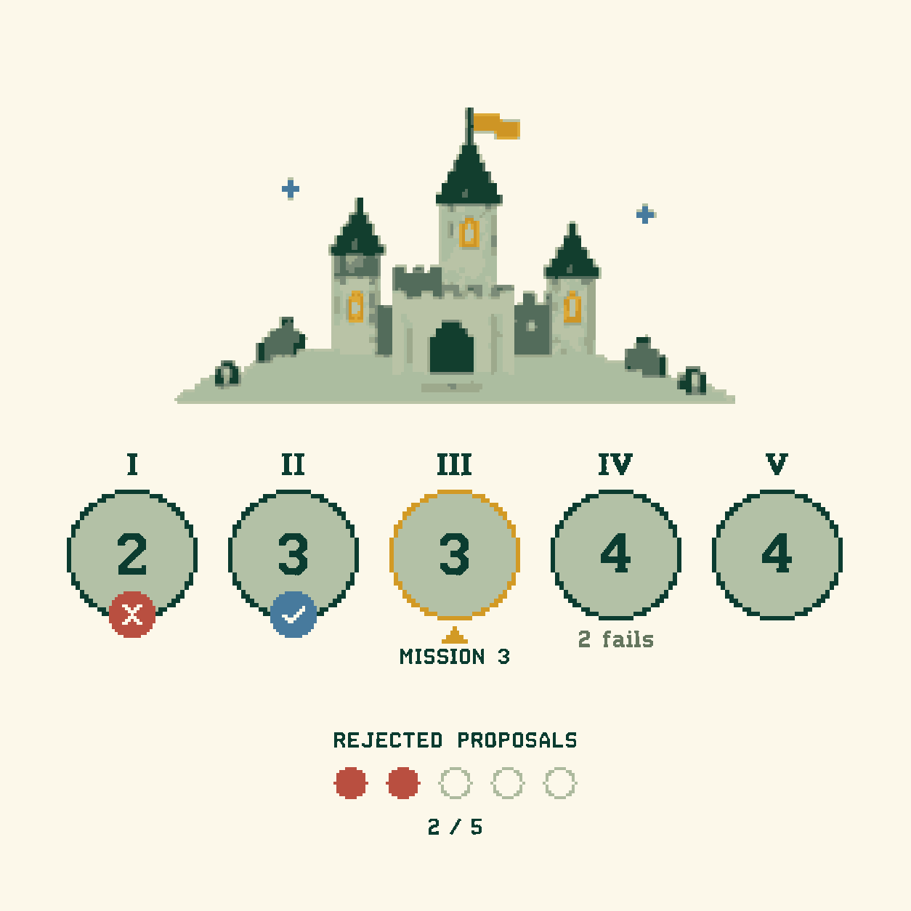

# Minimal Avalon asset package

An editable vector recreation of the approved square board: a large pixel castle, five mission circles, and a compact rejected-proposal track. No title or decorative border.

## Start here

- Open **preview.html** in a browser. It works offline and lets you change the active mission, mission outcomes, and rejected-proposal count, then download the resulting SVG.
- Use **svg/board.svg** for the approved example state.
- Use **svg/board-blank.svg** for a board with no active mission, no results, and zero rejections.
- Use **svg/board-background.svg** for the castle and ivory background without trackers.
- Use **svg/castle.svg** as a transparent standalone castle.
- **png/** contains matching PNG exports; **png/board@2x.png** is 2508 × 2508.

## Assets

| Path | Purpose |
| --- | --- |
| `svg/board.svg` | Complete 1254 × 1254 example board |
| `svg/board-transparent.svg` | Complete board without the outer ivory background |
| `svg/mission-1.svg` … `mission-5.svg` | Individual mission components in the example state |
| `svg/mission-empty.svg` | Pending mission component |
| `svg/mission-current.svg` | Highlighted mission component |
| `svg/rejections-0.svg` … `rejections-5.svg` | All six rejection-count states |
| `svg/icons/success.svg`, `fail.svg` | Outcome badges |
| `svg/icons/current-ring.svg`, `current-pointer.svg` | Active-mission overlays |
| `svg/icons/proposal-filled.svg`, `proposal-empty.svg` | Proposal dots |
| `svg/sprite.svg` | Reusable SVG symbols |
| `palette.json`, `tokens.css` | Named interface colors |
| `layout.json` | Exact component coordinates and example state |
| `assets.json` | SVG inventory and dimensions |
| `src/avalon-assets.mjs` | Dependency-free JavaScript SVG renderer |
| `src/castle.json`, `castle-data.mjs` | Castle paths grouped by color |
| `reference/approved-design.png` | Original approved raster reference |

## Drop in an image

```html

```

## Update game state from JavaScript

Serve your app normally when importing modules; the included preview needs no server because it inlines the module.

```js
import { renderBoard } from './src/avalon-assets.mjs';

document.querySelector('#board').innerHTML = renderBoard({
  currentMission: 3,                   // 1–5, or null
  teamSizes: [2, 3, 3, 4, 4],
  missionResults: ['fail', 'success', null, null, null],
  requiredFails: [1, 1, 1, 2, 1],
  rejectedProposals: 2,                // 0–5
});
```

The default layout follows the seven-player board shown in the design. To use another player count, pass that game's team sizes and fail thresholds. The renderer displays state; your game owns validation of moves, progression, vote resets, and win conditions.

Other exports: `renderCastle()`, `renderBackground(options)`, `renderMission(options)`, `renderRejectionTrack({count})`, `renderIcon(name)`, `PALETTE`, and `DEMO_STATE`.

```js
renderMission({number: 4, teamSize: 4, requiredFails: 2, current: true});
renderRejectionTrack({count: 3});
renderBoard({palette: {background: '#FFFFFF', gold: '#BF8E20'}});
```

Only pass trusted CSS color strings in `palette`. Palette changes affect the interface colors; the castle keeps its approved colors, editable in `castle.json` / `castle-data.mjs` or the SVG color groups.

## SVG sprite

```html
<svg viewBox="0 0 792 424" role="img" aria-label="Castle">
  <use href="./svg/sprite.svg#castle"></use>
</svg>
```

Use external symbols through a normal web server. For environments that restrict external `<use>` references, inline the symbol or use the standalone SVG file.

## Editing

Every SVG contains real paths, with no embedded PNG, external image, script, filter, or font. The castle has nine named color groups. Board groups identify the castle, each mission, and the rejection tracker.

Text and numerals are vector pixel glyphs, so their appearance does not depend on an installed font. Change labels and values in the JavaScript source, then rebuild. SVG editors see these glyphs as editable shapes rather than live text.

The castle was traced onto a 4 px grid and a reduced palette. The main labels and numerals were traced from the approved artwork; supplemental dynamic glyphs and tracker shapes are clean vector primitives. This preserves the approved composition and look but intentionally removes the generated raster's grain and soft shading. It is a vector recreation, not a byte-for-byte image conversion.

The transparent board omits the outer background; outlined empty proposal dots retain an ivory interior, which you can recolor with `palette.background`.

## Rebuild

Requires Node.js with ES modules. No packages are required for SVG generation.

```sh
node src/build.mjs
```

Optional PNG export uses `sharp`:

```sh
npm install sharp
node src/build.mjs --png
```

Optional castle retrace uses Python, Pillow, and NumPy:

```sh
python src/vectorize-castle.py
node src/build.mjs --png
```

For the crispest pixel edges, display at an integer scale, or render the SVG directly at the intended output size. Keep the square aspect ratio of the complete board.
